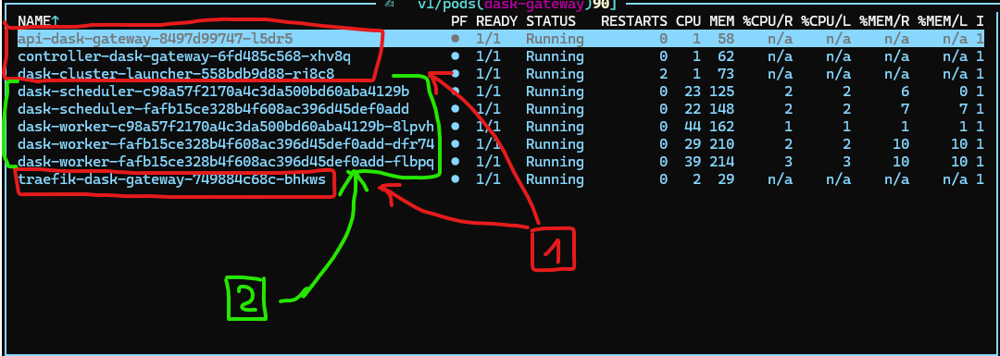
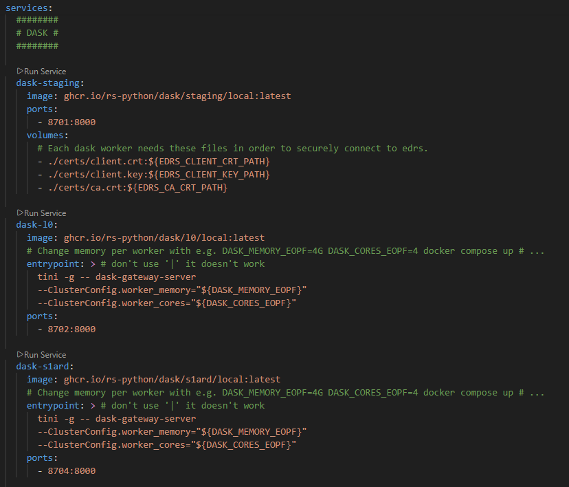

# Dask images

[Dask](https://www.dask.org/) is the library used by RS-Python for the parallel computing of the resource-intensive
tasks: the staging tasks and the DPR processors. Each kind of task needs a Docker image that contains its code and
dependencies, with a Dask version compatible with them. This page describes these images.

## Python and Dask versions

A Dask client (Jupyter kernel, rs-server-staging, rs-dpr-service) must use **the same Python and Dask versions** as
the Dask cluster it connects to. As the processors don't all use the same versions (they depend on the version of
[EOPF CPM](https://cpm.pages.eopf.copernicus.eu/eopf-cpm/main/index.html) they use), several combinations coexist.
They are listed in [`docker/scripts/dask-cluster-versions.yml`](https://github.com/RS-PYTHON/rs-workflow-env/blob/develop/docker/scripts/dask-cluster-versions.yml),
which is the reference used to build:

- the Dask base images,
- one Jupyter kernel per combination in the JupyterHub image, so a notebook can connect to any Dask cluster,
- one rs-dpr-service image per combination (`rs-dpr-service_py<python>-<dask>`), see
  [DPR processors](https://github.com/RS-PYTHON/rs-dpr-service/blob/develop/docs/doc/index.md#deployment).

## Cluster mode and local mode

In **cluster mode**, a central Dask Gateway server is deployed by rs-workflow-env with its Helm chart. It creates the
Dask clusters on demand: each cluster (a scheduler and its workers) is created from a Docker image. These images only
need the Dask client libraries and the code to run. Their name ends with `k8s`, e.g. `ghcr.io/rs-python/dask/l0/k8s`,
and they only work in cluster mode.

The screenshot above shows the Dask Gateway server (1), deployed once and maintained by the administrators, and two
Dask clusters (2) created from Docker images such as `ghcr.io/rs-python/dask/l0/k8s`. The clusters are created,
scaled and removed on demand.

In **local mode** ([Docker Compose](https://github.com/RS-PYTHON/rs-demo/blob/develop/docs/local-mode.md)), there is no
Helm chart and no central Dask Gateway: each Dask image also contains the `dask-gateway-server` library and runs its
own Dask Gateway server, as a single container. Their name ends with `local`, e.g. `ghcr.io/rs-python/dask/l0/local`.
They are used for development only.

## Base images

The Dask images are built in two steps: first the base images, then the processor and staging images from the base
images. The base images contain [Dask](https://www.dask.org/), [distributed](https://distributed.dask.org/) and
[Dask Gateway](https://gateway.dask.org/) (plus `dask-gateway-server` for the local mode). They are built for each
target (`k8s` or `local`) and each Python and Dask version, with the tag `<target>-py<python version>-<dask version>`,
e.g. `ghcr.io/rs-python/dask/dask-gateway:k8s-py3.13.16-2026.3.0`.

The files to build them are in the [`docker/base`](https://github.com/RS-PYTHON/rs-workflow-env/tree/develop/docker/base)
folder: Dockerfiles for the Dask (`Dockerfile.dask.k8s`, `Dockerfile.dask.local`), Jupyter and Python base images, and
the `build-base-images.sh` script. They are built by the CI of rs-workflow-env.

## Processor images

The images of the DPR processors are built from the base images by the
[`docker/eopf/build_dask_eopf.py`](https://github.com/RS-PYTHON/rs-workflow-env/blob/develop/docker/eopf/build_dask_eopf.py)
script, run by the CI of rs-workflow-env, that defines the Python and Dask versions of each image. For each processor,
three images are built:

| Image | Usage |
|---|---|
| `ghcr.io/rs-python/dask/<processor>/k8s` | Cluster mode. |
| `ghcr.io/rs-python/dask/<processor>/local` | Local mode. |
| `ghcr.io/rs-python/dask/<processor>/localcluster` | Debugging in local mode: rs-dpr-service and the processor in the same image, run with a Dask `LocalCluster` (see the [experimental configurations](https://github.com/RS-PYTHON/rs-dpr-service/blob/develop/docs/doc/index.md#experimental-configurations)). |

The images are available for the Level-0 processors (`l0`), the Sentinel-1 ARD processor (`s1ard`), the Sentinel-3
OLCI processors (`s3olci`), and generic images with the EOPF CPM major versions (`cpm2`, `cpm3`). The processors and
their dependencies are installed from the `requirements-dask-<processor>.txt` files (and optional
`system-requirements-*` and `post-install-*` files) of the
[`docker/eopf/resources`](https://github.com/RS-PYTHON/rs-workflow-env/tree/develop/docker/eopf/resources) folder.

The image of the mockup processor (`ghcr.io/rs-python/dask/mockup/<target>`) is built by
[rs-testmeans](https://github.com/RS-PYTHON/rs-testmeans).

## Staging images

The staging images, `ghcr.io/rs-python/dask/staging/k8s` and `ghcr.io/rs-python/dask/staging/local`, are built from
the base images by the CI of [rs-server](https://github.com/RS-PYTHON/rs-server), with the
[`Dockerfile.dask-staging`](https://github.com/RS-PYTHON/rs-server/blob/develop/services/staging/.github/Dockerfile.dask-staging)
file. They contain the `rs_server_staging` and `rs_server_common` packages. See
[Staging internals](https://github.com/RS-PYTHON/rs-server/blob/develop/docs/doc/dev/staging-internals.md).

## Jupyter environments

As a notebook must use the same Python and Dask versions as the Dask cluster it connects to, the Jupyter image
contains one virtual environment (and Jupyter kernel) per combination of `dask-cluster-versions.yml`. The rs-demo
helpers that create Dask clusters (`notebooks/resources/dask_clusters`) run in the right environment, as a
sub-process if needed (see [Add and delete Dask clusters](dask-clusters.md)).
